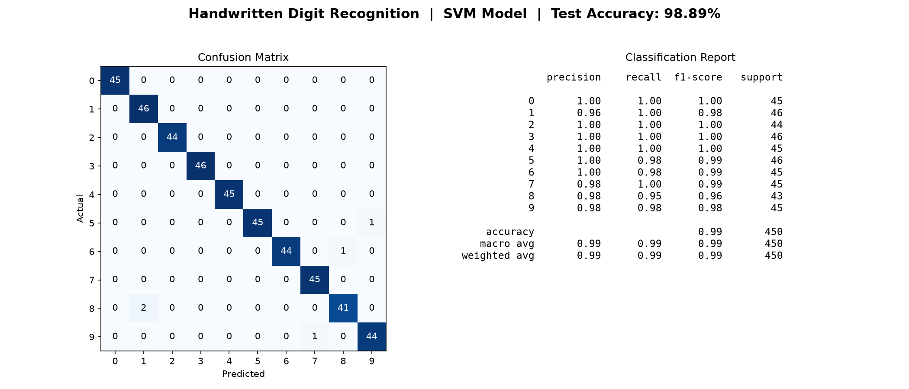
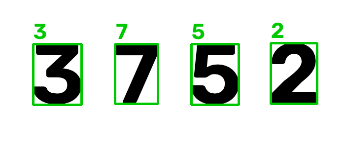

# Handwritten Digit Recognition — OpenCV + Machine Learning

A computer vision project that recognizes handwritten digits (0–9). It trains
a Machine Learning model, measures its accuracy on unseen data, and uses
**OpenCV** to detect and label digits inside an image.

Built as a hands-on way to understand the full pipeline — from raw pixels to a
labelled prediction — not just calling a pre-trained black box.

---

## What it does

- Trains an **SVM** classifier on 1,797 handwritten digit images
- Reports **honest test accuracy** on data the model never saw during training
- Generates a **confusion matrix** and per-digit performance report
- Runs a full **OpenCV pipeline** on an image: grayscale → blur → threshold →
  contour detection → crop → predict → draw bounding box + label

---

## Results

**Test Accuracy: 98.89%** (450 unseen test images)



### OpenCV detection on a test image



Each detected digit is boxed in green with its predicted value on top.

---

## Project identity

| | |
|---|---|
| Category | Artificial Intelligence |
| Field | Machine Learning (not deep learning) |
| Learning type | Supervised Learning |
| Task | Multi-class Classification (10 classes: 0–9) |
| Model | SVM (Support Vector Machine) |
| Vision library | OpenCV |

---

## Tech stack & why

| Tool | Role | Why |
|---|---|---|
| **Python** | Language | Standard for ML; rich library ecosystem |
| **scikit-learn** | Model + dataset | Provides the SVM and the digits dataset |
| **SVM** | The model | Accurate on small data, fast, trains on CPU |
| **OpenCV** | Computer vision | Image loading, thresholding, contours, drawing |
| **NumPy** | Numeric arrays | An image is a grid of numbers — handled fast |
| **Matplotlib** | Charts | Builds the accuracy/confusion-matrix image |
| **joblib** | Save/load model | Train once, reuse the saved model |

---

## The pipeline

Dataset → train/test split → SVM training → accuracy + confusion matrix
│
Image → grayscale → blur → threshold → contours → crop → predict → draw box


---

## How to run

```bash
# 1. Create and activate a virtual environment
python -m venv venv
venv\Scripts\activate        # Windows
# source venv/bin/activate   # Mac/Linux

# 2. Install dependencies
pip install -r requirements.txt

# 3. Train the model (prints accuracy, saves model.pkl)
python train.py

# 4. Save the accuracy results image
python report.py

# 5. Run OpenCV detection on an image
python make_test_image.py            # creates a sample image
python detect_image.py test_digits.png   # saves result.png
```

---

## Files

| File | Purpose |
|---|---|
| `train.py` | Train the SVM, print accuracy, save the model |
| `report.py` | Save a clean accuracy report image |
| `detect_image.py` | OpenCV pipeline — detect digits in an image |
| `make_test_image.py` | Generate a sample test image |
| `requirements.txt` | Dependencies |

---

## Honest note on real-world performance

The model scores **98.89%** on the clean 8×8 dataset. On images with very
different fonts or styles it can still make mistakes — because it only learned
from one kind of data. This gap between lab accuracy and real-world input is
one of the most important lessons in applied computer vision.

---

## Next steps

- Try a `RandomForestClassifier` and compare accuracy
- Move from 8×8 to higher-resolution inputs
- Train on a custom dataset (own handwriting)
- Replace SVM with a CNN (deep learning) for tougher real-world images